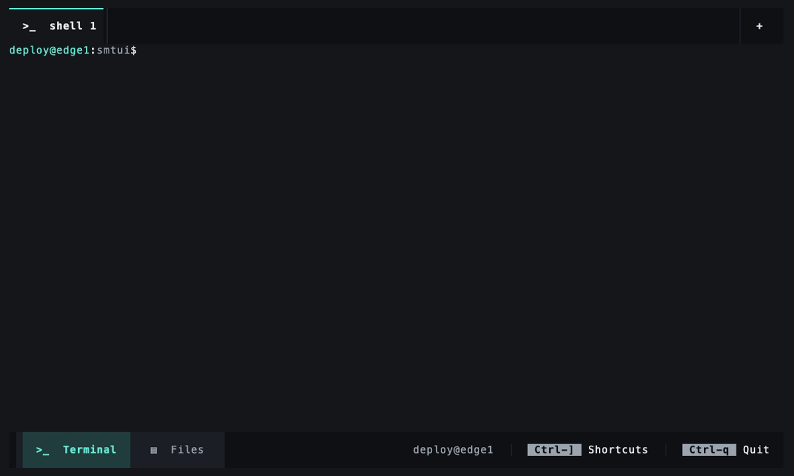

# smtui — server manager TUI



A terminal UI that runs **on the server**, with mouse and keyboard support. It has two modes:

- **Terminal**: real local shells (`$SHELL -l`) in tabs, using a PTY plus a VT100 emulator.
- **Files**: a file browser with tabs, multi-selection, two-step copy/move/paste and a
  "Copy scp command" action for downloading files to your machine.

The usual workflow:

```sh
ssh deploy@edge1
tmux new -s work
smtui            # or: smtui /var/www
```

## Install

Download a static Linux binary from the [releases](https://github.com/hitaloose/smtui/releases) page, on the server:

```sh
mkdir -p ~/.local/bin
arch=$(uname -m)   # x86_64 or aarch64
version=$(curl -fsSL https://api.github.com/repos/hitaloose/smtui/releases/latest | sed -n 's/.*"tag_name": *"\([^"]*\)".*/\1/p')
curl -fsSL "https://github.com/hitaloose/smtui/releases/download/${version}/smtui-${version}-${arch}-unknown-linux-musl.tar.gz" \
  | tar -xz --strip-components=1 -C ~/.local/bin "smtui-${version}-${arch}-unknown-linux-musl/smtui"
smtui --version
```

This installs the latest release; run it again to update. For a specific version, set
`version=v0.2.0` instead of querying the API.

Releases are built by `.github/workflows/release.yml` when a `v*` tag is pushed.

To build it yourself instead, cross-compile and copy it to the server:

```sh
rustup target add x86_64-unknown-linux-musl     # or aarch64-unknown-linux-musl
cargo install cargo-zigbuild                     # cross-compiles from macOS without Docker
cargo zigbuild --release --target x86_64-unknown-linux-musl
scp target/x86_64-unknown-linux-musl/release/smtui deploy@edge1:~/.local/bin/
```

`smtui --demo` starts with an in-memory sample file system, which is handy for trying the UI.

## tmux setup

Add to `~/.tmux.conf` on the server:

```tmux
set -g mouse on                 # pass clicks and scrolling to smtui
set -g set-clipboard on         # let "Copy scp command" reach your local clipboard (OSC 52)
set -g allow-passthrough on     # tmux >= 3.3
set -as terminal-features ',*:RGB'   # 24-bit color, if your terminal supports it
```

Your local terminal must also allow OSC 52 clipboard writes (iTerm2: *Preferences › General ›
Selection › Applications in terminal may access clipboard*; kitty, WezTerm, Alacritty, Windows
Terminal and recent GNOME terminals support it). If nothing reaches the clipboard, the command is
always shown on screen so you can copy it by hand.

## Keys

The mouse works everywhere: click tabs, `×` closes a tab, `+` opens one, the bottom bar switches
modes, **× Quit** (bottom right) exits, right click opens the context menu.

`Ctrl+Q` is reserved for quitting, so it never reaches programs in the terminal (it is the
XON flow-control key in most shells and rarely used).

**Global** (in Files mode directly; in Terminal mode after the leader key, default `Ctrl+]`):

| Key | Action |
|---|---|
| `Ctrl+]` then `t` | New tab |
| `Ctrl+]` then `w` | Close tab |
| `Ctrl+]` then `n` / `p` | Next / previous tab |
| `Ctrl+]` then `1`…`9` | Switch mode |
| `Ctrl+]` then `?` (or `?` in Files) | Shortcuts menu |
| `Ctrl+Q` (any mode), `Ctrl+]` then `q`, or the **Quit** button | Quit |
| `Ctrl+]` `Ctrl+]` | Send `Ctrl+]` to the shell |
| `Ctrl+T`, `Ctrl+W`, `Tab` / `Shift+Tab`, `F1`/`F2`, `q` | Same, in Files mode |

**Files**

| Key / mouse | Action |
|---|---|
| Click | Select one item |
| `Ctrl`+click | Add to / remove from the selection |
| `Shift`+click | Select a range |
| Click on empty space | Clear the selection |
| Double click, `Enter` | Open folder |
| `↑` `↓` `PgUp` `PgDn` `Home` `End` | Move the cursor |
| `Space` | Toggle the cursor item in the selection |
| `Backspace`, `←` | Up one level |
| `Ctrl+A` / `Esc` | Select all / clear selection |
| Right click, `o`, `Menu`, `Shift+F10` | Context menu |
| `c` / `m` | Copy / Move (mark the items, then Paste in the destination) |
| `v` | Paste here |
| `s` | Copy scp command |
| Drop files on the window | Copy an `scp` command that uploads them into the open folder (or the selected one) |
| `u` | Copy an upload command with a `<LOCAL_PATH>` placeholder |
| `z` | Compress the selection to `name.tar.gz` (never overwrites: `name (2).tar.gz`…) |
| `t` | Open a terminal tab in the selected folder (or the current one) |
| `.` | Toggle hidden files (also in the Shortcuts menu) |
| `r`, the **↻** button | Refresh the folder (e.g. after an upload) |
| `Delete`, `d` | Delete the selection (asks you to type `DELETE` to confirm) |

**Uploading from your computer.** smtui runs on the server, so it cannot read your local files,
but it can write the command for you: drag files from Finder (or your file manager) onto the
terminal window while in Files mode. Terminals paste the dropped paths as text; smtui turns them
into `scp -r <your files> user@host:<open folder>/`, copies it to your clipboard, and you run it in
a local terminal. "Copy upload command" in the context menu (or `u`) does the same with a
`<LOCAL_PATH>` placeholder.

Copy and Move work in two steps: mark the items, open the destination (in any tab) and Paste.
Name clashes become `name (copy)`, `name (copy 2)`…; moving into the same folder and pasting a
folder into itself are skipped with a notice. Tabs open inside a moved folder follow it.

> **Ctrl+click, not Cmd+click.** Terminals do not pass Cmd+click to applications. Some terminals
> also treat Ctrl+click as a right click (macOS Terminal.app); use `Space` or Shift+click there.

## Configuration

`~/.config/smtui/config.toml` (every key is optional):

```toml
accent = "#5eead4"     # highlight color
leader = "ctrl-]"      # prefix for global shortcuts in Terminal mode
show_hidden = true     # show dotfiles
# truecolor = true     # force 24-bit color (auto-detected from $COLORTERM)

[scp]                  # how *you* reach this server, for the copied scp command
# host = "edge1"       # default: server IP from $SSH_CONNECTION, then the hostname
# user = "deploy"      # default: current user
# port = 22            # default: port from $SSH_CONNECTION; `-P` is added when not 22
```

Logs go to `~/.local/state/smtui/smtui.log` (level via `SMTUI_LOG=debug`).

## Development

```sh
cargo test
cargo clippy --all-targets
cargo run -- --demo
```

The GIF above is recorded with [VHS](https://github.com/charmbracelet/vhs) from `docs/demo.tape`:
`cargo build --release && vhs docs/demo.tape`.

New modes implement the `Mode` trait in `src/modes/mod.rs` and are registered in `src/main.rs`;
the tab bar and the bottom bar are generated from the registered modes.
